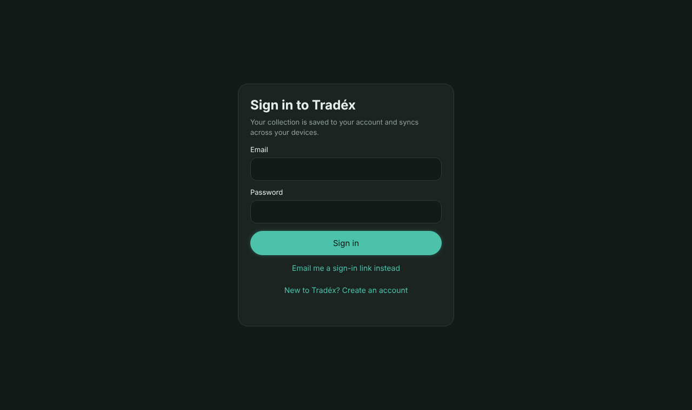
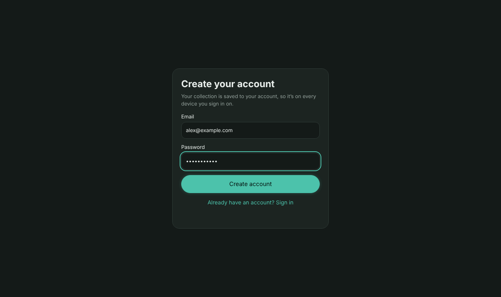
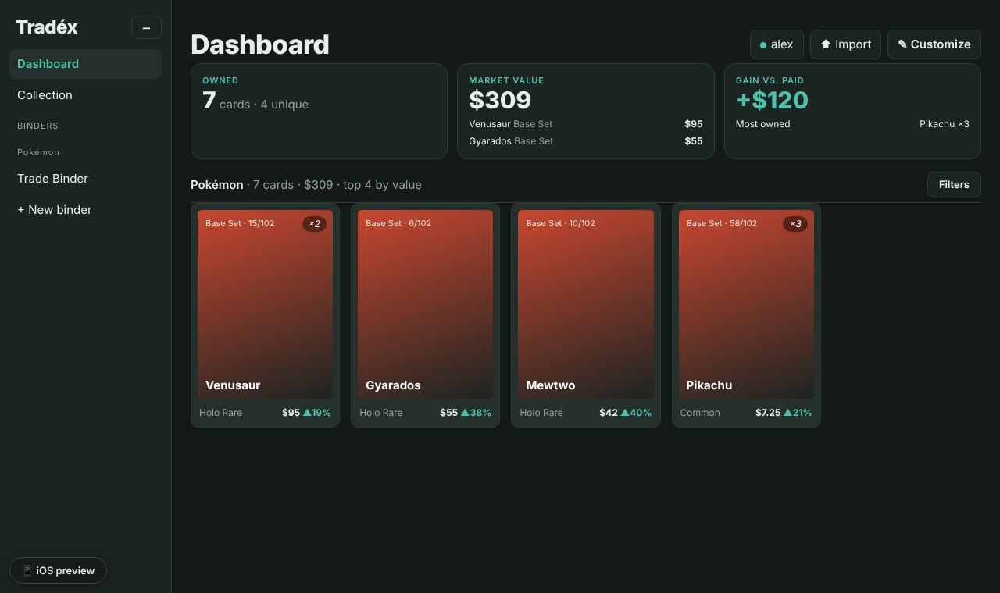
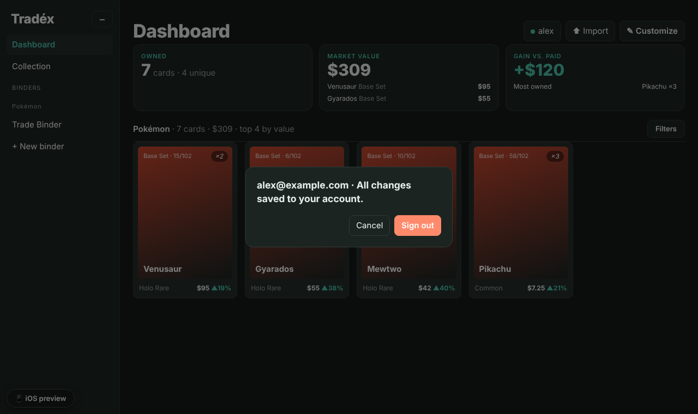
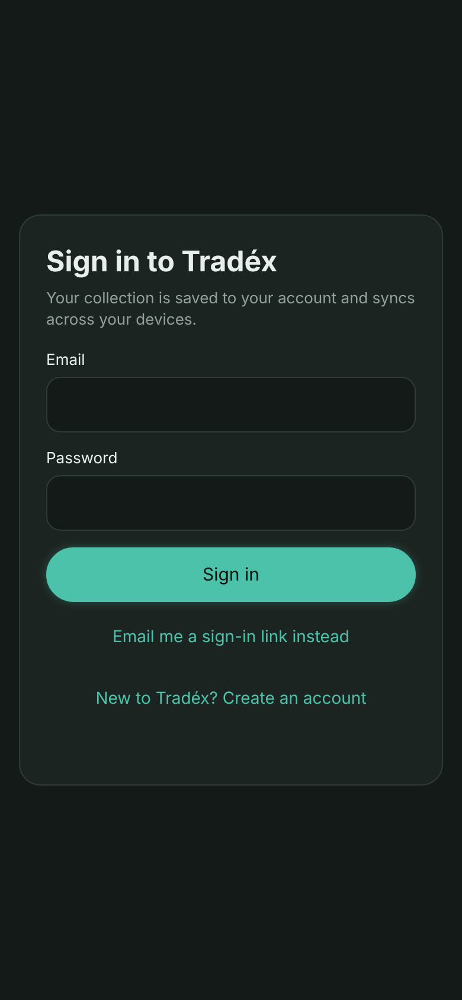
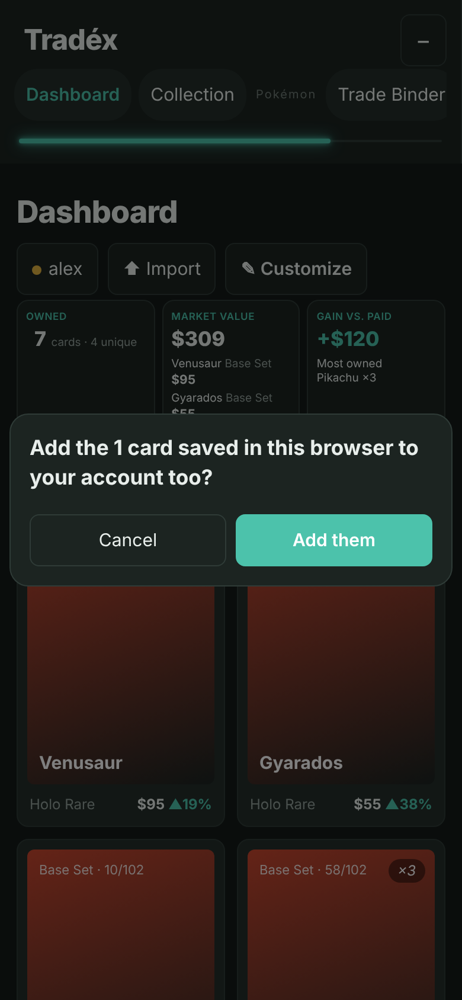
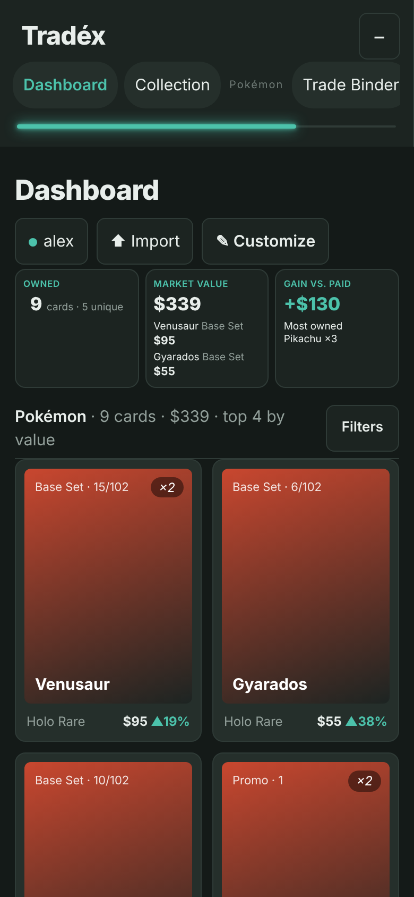
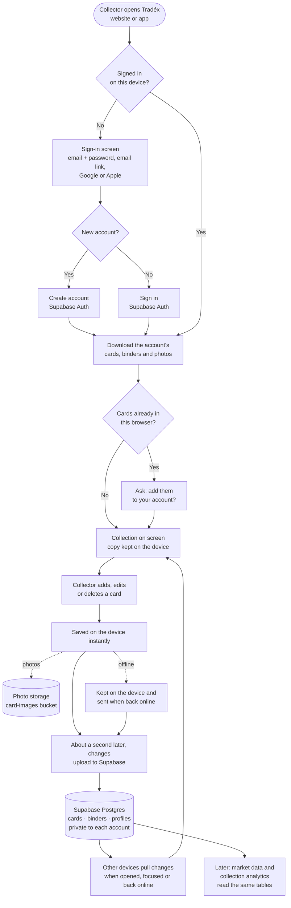

# Accounts and sync: preview and how it works

Screenshots are from the real app, with a stand-in for Supabase. The flow chart below is the same as `flow.png`.

| Sign in | Create account | Signed in (green dot = saved) | Account menu |
|---|---|---|---|
|  |  |  |  |

| Phone sign-in | Keep cards already on this phone | Synced |
|---|---|---|
|  |  |  |

## Sign up first, verify later

New accounts go straight into the app. Right after sign-up Tradéx emails a verification link, and a bar at the bottom of the app asks the person to open it (with **Resend**). Opening the link signs them in and records the address as verified (`tx_verified` on the account), and the bar goes away. Google and Apple accounts count as verified already.

Two settings in the Supabase dashboard make this work:

1. **Authentication → Sign In / Providers → Email → Confirm email: off.** With it on, Supabase refuses to sign anyone in until they confirm, so sign-up falls back to the old "check your email" screen.
2. **Authentication → Emails → Magic Link** (optional): the verification email uses this template. Change the subject to something like "Verify your Tradéx email" and the button text to "Verify email" so it reads as a verification rather than a sign-in link.

Supabase's built-in mailer only sends a few emails an hour, so set up custom SMTP (Authentication → Emails → SMTP Settings) before launch.
