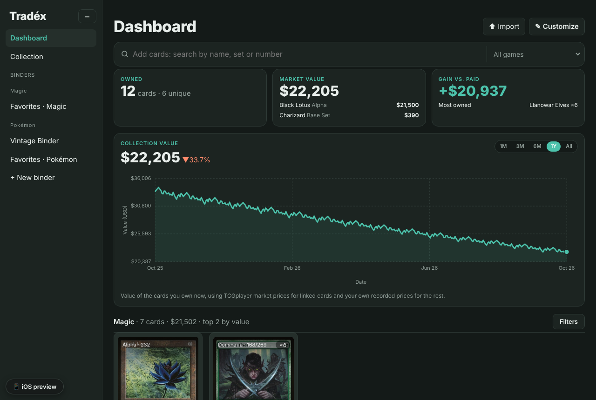
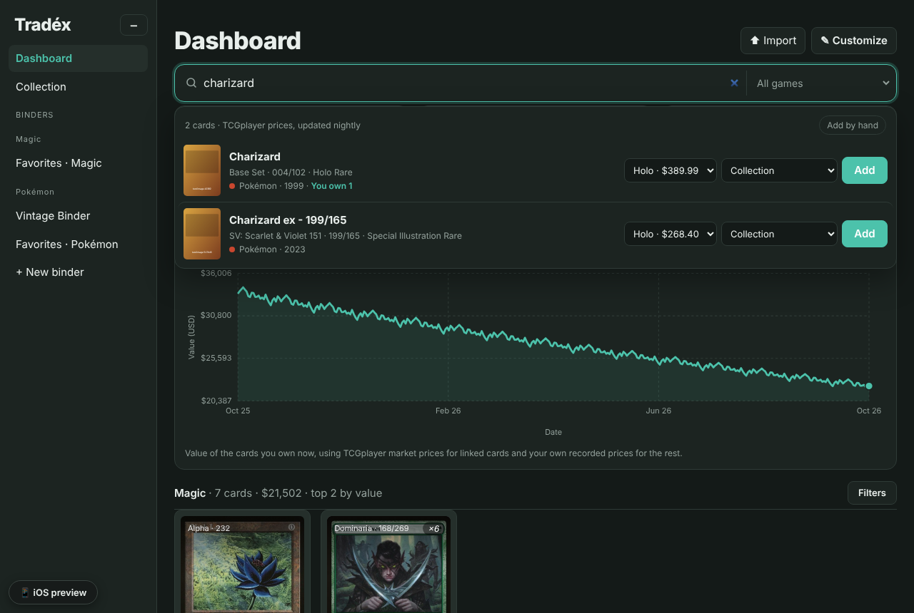
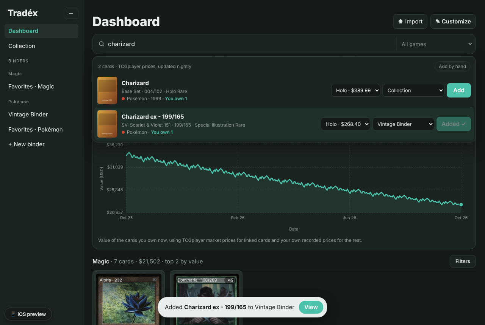
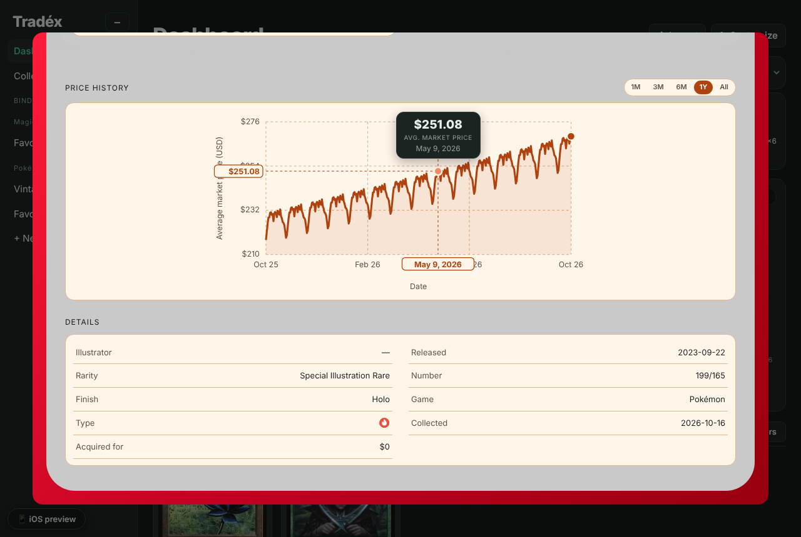
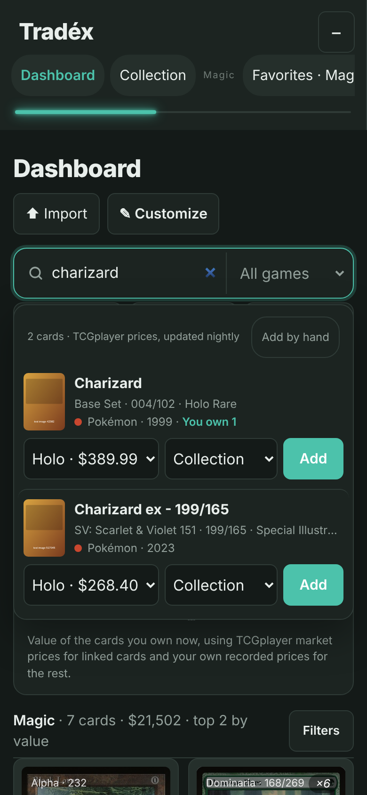
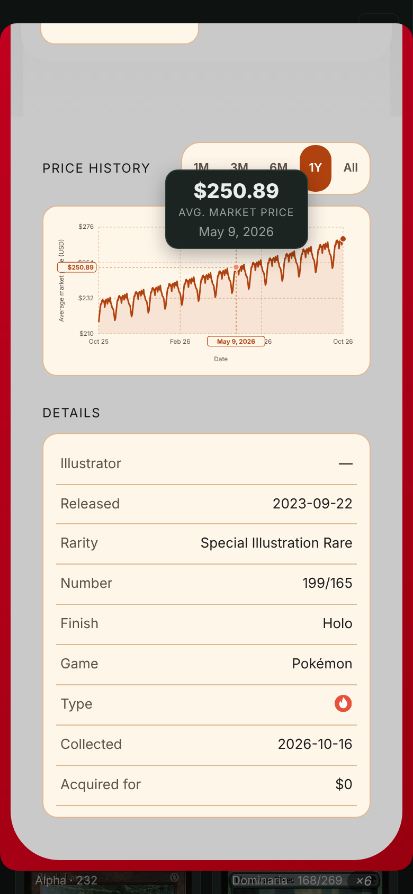

# Card database previews

Screenshots of the Add cards search bar, the collection value chart and a card's price history.
They were taken with test data: the card sources were stood in for by `test/mock-upstream.js`, the card pictures are placeholders, and the price history is generated. Real names, sets and numbers; example prices.

| | |
| --- | --- |
| Dashboard with the search bar and collection value chart |  |
| Searching for "charizard" |  |
| Added to a binder in one tap |  |
| Price history with range buttons |  |
| Phone: search |  |
| Phone: price history |  |
